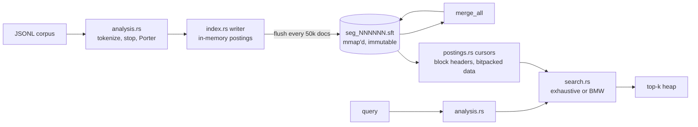

# sifter

A BM25 full-text search engine in Rust, with an mmap'd segment format, bitpacked block postings and an exact block-max WAND evaluator. On three BEIR datasets its ranking quality is within 0.0016 nDCG@10 of [tantivy](https://github.com/quickwit-oss/tantivy) with the same BM25 parameters. Its exhaustive scorer has lower median latency than tantivy on every BEIR corpus measured, but is 44% slower than tantivy at k=10 on a 1.15M-document corpus.

[](https://github.com/eshaan2418/sifter/actions/workflows/ci.yml)
[](LICENSE)


## Why this exists

Search engine tutorials usually stop at an inverted index in a `HashMap` and a score loop, and they never check whether the results are any good. sifter is built the way production engines are: immutable on-disk segments, block-compressed postings with per-block score bounds, and dynamic pruning. It is measured the way IR research is, with standard BEIR test collections, graded relevance judgments and trec_eval-style metrics, against a mature engine configured identically. A CI job downloads SciFact and fails the build if nDCG@10 (k1=1.2, b=0.75) drops below 0.68, or if block-max WAND and exhaustive evaluation disagree.

The second goal was to find out whether block-max WAND is worth its complexity at laptop scale. In this implementation it is not; the details are below.

## Highlights

- **Relevance matches tantivy.** With k1=1.2 and b=0.75, nDCG@10 is 0.6827 vs 0.6842 on SciFact, 0.3228 vs 0.3218 on NFCorpus and 0.2512 vs 0.2506 on FiQA.
- **Segment format.** Each segment is one immutable file opened with `mmap`. It holds postings, a doc-length table, external ids, a sorted term dictionary and a footer of section offsets and magic bytes. A commit atomically replaces `meta.json`, so a crash leaves either the old segment set or the new one. Merging rewrites all segments into one.
- **Block postings.** Postings are stored in blocks of 128 documents, with doc-id deltas and term frequencies bitpacked at the smallest width that fits. Fixed-size 24-byte block headers carry `last_doc`, `max_tf` and `min_len`, so cursors can skip blocks without decoding them.
- **Exact block-max WAND** (Ding & Suel, SIGIR 2011). It returns the same hits with bit-identical scores as exhaustive evaluation, checked on 1,800 randomized queries. Scores are summed in query order and ties go to the lower doc number.
- **Lucene-style analysis.** The analyzer tokenizes, lowercases, strips possessives, removes the Lucene English stop list and applies the Porter (1980) stemmer, which is checked against 76 reference stemming cases.
- **Corpus-wide statistics.** idf and average length are computed over the whole index, so results don't change when segments are merged.

## Quick start

Requires Rust 1.85 or newer. The datasets are about 64 MB of BEIR zips, downloaded into `./data`.

```sh
git clone https://github.com/eshaan2418/sifter && cd sifter
make build test
make data eval      # index + evaluate SciFact, NFCorpus, FiQA
make bench          # full comparison with tantivy, writes bench/results/beir.json
make demo
```

## Usage

The corpus is BEIR-style JSONL (`{"_id", "title", "text"}`), one document per line.

```sh
$ sifter index /tmp/idx data/scifact/corpus.jsonl
indexed 5183 docs into 1 segment(s), 2194829 bytes, in 0.21s
$ sifter search /tmp/idx "vitamin D deficiency increases risk of respiratory infections" -k 3
  1. 23267371       11.3782
  2. 275294         10.9014
  3. 30720103       10.8899
0.046 ms, 2442 docs scored, 0 blocks skipped
$ sifter merge /tmp/idx
$ sifter eval /tmp/idx data/scifact/queries.jsonl data/scifact/qrels/test.tsv --k1 1.2 --b 0.75
{"engine": "sifter", "algorithm": "Exhaustive", "queries": 300, "ndcg@10": 0.6827, ...}
```

Add `--bmw` to `search` or `eval` to use block-max WAND. The defaults are k1=0.9 and b=0.4, which are Anserini's BM25 defaults.

As a library:

```rust
use sifter::{Index, Searcher, Bm25, Algorithm};

let mut idx = Index::create(std::path::Path::new("/tmp/idx"))?;
idx.add("doc1", "Rust is a systems programming language")?;
idx.add("doc2", "Search engines rank documents with BM25")?;
idx.commit()?;
let s = Searcher::new(&idx, Bm25::default());
let (hits, _stats) = s.search("ranking documents", 10, Algorithm::Exhaustive);
```

## Architecture



Segment layout, posting format, the pruning bound and the exactness argument are covered in [docs/DESIGN.md](docs/DESIGN.md).

## Benchmarks

**Setup:** Apple M5 Pro, 48 GB, macOS 27.0.1, rustc 1.99.1, `--release`. Each engine indexes the corpus, and sifter's segments are then merged into one. Every BEIR test query runs once at k=100 (used for relevance) and once at k=10. Latency is the median, over 5 runs, of each run's p50 per-query time, measured in-process with analysis included. The baseline is tantivy 0.27.0 with the same pipeline: simple tokenizer, lowercase, Lucene stop list, Snowball English stemmer and BM25 k1=1.2/b=0.75. The `fiqa20` corpus is FiQA replicated 20 times (1,152,760 documents) and is used for latency only. Reproduce with `make bench`. The raw results are in [`bench/results/beir.json`](bench/results/beir.json) and [`bench/results/pruning.json`](bench/results/pruning.json).

### Relevance (nDCG@10 / Recall@100, BEIR test split)

| Dataset | docs | sifter (k1 .9, b .4) | sifter (k1 1.2, b .75) | tantivy (k1 1.2, b .75) |
|---|---:|---:|---:|---:|
| SciFact | 5,183 | 0.6759 / 0.9287 | 0.6827 / 0.9276 | 0.6842 / 0.9216 |
| NFCorpus | 3,633 | 0.3210 / 0.2457 | 0.3228 / 0.2460 | 0.3218 / 0.2483 |
| FiQA | 57,638 | 0.2353 / 0.5400 | 0.2512 / 0.5526 | 0.2506 / 0.5515 |

Small differences remain, and they come from analysis: Porter vs Snowball stemming, and tokenizer edge cases such as `3.5x`. The scoring formula is the same. Block-max WAND produces exactly the same rankings as exhaustive evaluation, so it has no column here.

### Query latency (p50, k1=1.2 b=0.75)

| Corpus | docs | sifter exhaustive k=10 | sifter BMW k=10 | tantivy k=10 | sifter exhaustive k=100 | sifter BMW k=100 | tantivy k=100 |
|---|---:|---:|---:|---:|---:|---:|---:|
| SciFact | 5,183 | **0.031 ms** | 0.080 ms | 0.049 ms | **0.048 ms** | 0.123 ms | 0.097 ms |
| NFCorpus | 3,633 | **0.005 ms** | 0.006 ms | 0.006 ms | **0.012 ms** | 0.014 ms | 0.015 ms |
| FiQA | 57,638 | **0.300 ms** | 0.782 ms | 0.316 ms | **0.332 ms** | 0.993 ms | 0.529 ms |
| fiqa20 | 1,152,760 | 5.892 ms | 10.776 ms | **4.090 ms** | **5.985 ms** | 14.712 ms | 6.952 ms |

Tail latency on fiqa20 (p99, k=10): sifter exhaustive 10.515 ms, sifter BMW 54.733 ms, tantivy 23.618 ms.

**What the numbers say:**

- **On small and medium corpora, sifter's exhaustive scorer is the fastest of the three.** It decodes each posting block once and accumulates into a dense per-segment score array, a tight loop with sequential memory access.
- **At 1.15M documents, tantivy wins at k=10 (4.09 vs 5.89 ms).** tantivy prunes effectively when the heap is small. At k=100 its pruning has less room, and sifter is faster (5.99 vs 6.95 ms). sifter's work is flat in k, so its p99 is also lower (10.5 vs 23.6 ms).
- **Block-max WAND is slower than exhaustive everywhere, even though it scores far less.** On fiqa20 at k=10 it scores 9,135 documents per query on average against 569,962, which is 62x fewer, and is still 1.8x slower. Each skip decision costs header lookups, a binary search per cursor and a re-sort of the cursor order. Those are branchy, cache-unfriendly operations, and at this scale they outweigh the scoring they avoid. An early version was about 2.4x slower still, because swapping ~1 KB cursor structs dominated the profile. Sorting an index permutation instead fixed that. BMW is kept because it is exact and tested, and it is where the roadmap work lands. Exhaustive is the default.

### Indexing

| Corpus | sifter index time | sifter index size (merged) | sifter peak RSS | tantivy index time |
|---|---:|---:|---:|---:|
| SciFact | 0.20 s | 2.2 MB | 21 MB | 0.46 s |
| NFCorpus | 0.14 s | 1.6 MB | 16 MB | 0.44 s |
| FiQA | 1.17 s | 9.4 MB | 67 MB | 0.72 s |
| fiqa20 | 22.94 s | 133.8 MB | 292 MB | 4.50 s |

sifter indexes on one thread, and its time excludes the separate `merge` step. tantivy's writer uses multiple indexing threads, and its time includes commit and merging. On large corpora tantivy indexes 5x faster. Parallel segment building is the obvious fix and is on the roadmap.

## Design decisions and trade-offs

- **Exact pruning rather than approximate pruning.** BMW only skips a block when its upper bound is `<=` the current threshold, using the same tie-break as the exhaustive path. That makes a strict equality test against the exhaustive path possible, so pruning bugs show up as test failures instead of as a slightly worse nDCG.
- **Global statistics.** BM25 uses `N`, `df` and average length over all segments. Per-segment statistics are cheaper, but they make scores depend on segment layout, so merging would change rankings.
- **Fixed-size block headers ahead of the data.** Skipping costs one 24-byte read per block, with no varint scanning. The cost is about 0.19 bytes per posting of header overhead.
- **Porter, not Snowball.** Porter matches what many BM25 baselines (Anserini/Lucene `PorterStemFilter`) use, and fits in under 300 lines. Using Snowball in tantivy leaves a small, measurable analysis difference, visible in the relevance table.
- **One `unsafe` block**, the `mmap` call. Segment files are immutable once renamed into place, and each is checked for its header and footer magic and for consistent section offsets when opened. Postings are not checksummed, so the engine detects a damaged footer but not bit rot inside the posting data.

## Testing

| What | How |
|---|---|
| BMW exactness | `tests/search.rs`: 60 random corpora × 3 BM25 parameter sets × 10 queries. BMW and exhaustive must return identical ids and scores. |
| Pruning | BMW must skip blocks and score fewer docs on selective queries |
| Durability | flush → merge → reopen preserves results; only the merged segment file remains; a segment with a damaged footer is rejected |
| Postings | bitpacking round-trips at every width from 0 to 32; seek and block-metadata tests |
| Analysis | 76 Porter reference cases; the full pipeline, with stop words, possessives, digits and non-ASCII |
| Metrics | nDCG/Recall/MRR against hand-computed values |
| Relevance regression | CI downloads SciFact, asserts nDCG@10 ≥ 0.68 at k1=1.2/b=0.75, and asserts that BMW and exhaustive produce identical metrics |
| Lints | `cargo clippy --all-targets -D warnings`, `cargo fmt --check` |

## Limitations and roadmap

- Single field, bag-of-words only. There are no phrase queries, positions, boolean operators or field boosts.
- No deletes or updates. The index is append-only, plus a full merge.
- Indexing is single-threaded, and the whole in-memory batch is held until a flush every 50,000 documents.
- No SIMD block decoding.
- BMW is slower than exhaustive, as described above.
- Roadmap: parallel segment building, SIMD bit-unpacking, MaxScore as a cheaper pruning baseline, positions for phrase queries, and tiered merging.

## Project structure

```
src/analysis.rs           tokenizer, stop words, Porter stemmer
src/postings.rs           block encoding, bitpacking, cursors
src/index.rs              segment writer/reader (mmap), meta.json, merge
src/search.rs             BM25, exhaustive and block-max WAND top-k
src/eval.rs               qrels parsing, nDCG@k, Recall@k, MRR@k
src/bin/sifter.rs         CLI: index, search, merge, eval
examples/tantivy_baseline.rs   the same pipeline on tantivy
tests/search.rs           BMW exactness, merge/reopen, corruption
scripts/bench.py          BEIR benchmark -> bench/results/beir.json
scripts/pruning.py        docs scored per query -> bench/results/pruning.json
docs/DESIGN.md            format and algorithm notes
```

## License

MIT. See [LICENSE](LICENSE).
